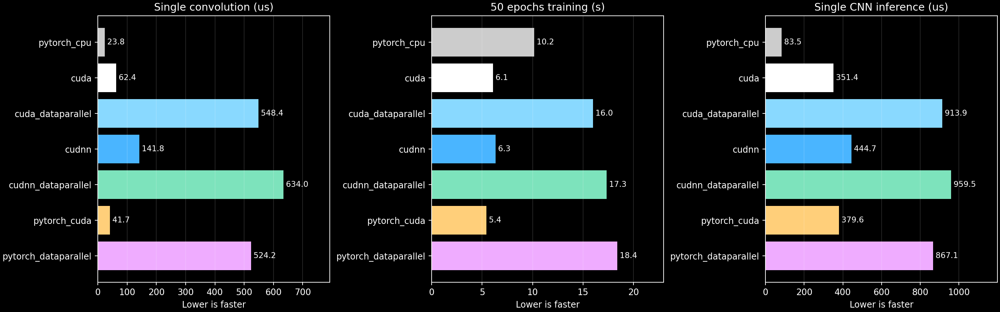
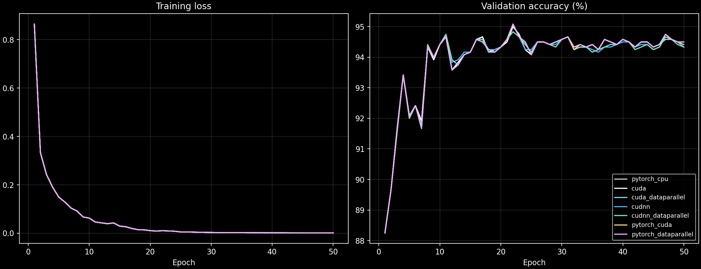

# CNN CUDA Case Study

**Inside a CNN: 2D convolution on CPU, one GPU and two GPUs.**

A small MNIST classifier with handwritten CPU/CUDA convolution, direct cuDNN calls and PyTorch baselines. The code is modular, the notebook fetches it from GitHub, and the results come from a completed Kaggle run.

[Expanded teaching deck](presentation/CNN_CUDA_Case_Study_Parallel_Computing.pptx) · [Presenter notes](presentation/CNN_CUDA_Presenter_Notes.md) · [Experiment notebook](notebooks/experiment.ipynb) · [Kaggle run](https://www.kaggle.com/code/satyapaladugu/cnn-cuda-case-study) · [Full report](reports/kaggle-2026-10-14/REPORT.md) · [Raw metrics](reports/kaggle-2026-10-14/all_results.json) · [Release artifacts](https://github.com/saltypal/CNN-CUDA-Case-Study/releases/tag/v1.0.0)

## What the experiment found

**All seven paths completed 50 epochs and classified 956 of 1,000 held-out digits correctly: 95.6% test accuracy.** One-GPU training was faster than CPU training. Two-GPU DataParallel was slower than its matching one-GPU implementation for this small CNN.

| Implementation | One convolution (us) | 50-epoch training (s) | Single-image inference (us) | Test accuracy |
|---|---:|---:|---:|---:|
| PyTorch CPU | 23.80 | 10.17 | 83.45 | 95.6% |
| Custom CUDA, 1 GPU | 62.41 | 6.06 | 351.39 | 95.6% |
| Custom CUDA, 2 GPUs | 548.40 | 15.99 | 913.92 | 95.6% |
| Direct cuDNN, 1 GPU | 141.80 | 6.34 | 444.74 | 95.6% |
| Direct cuDNN, 2 GPUs | 633.95 | 17.32 | 959.52 | 95.6% |
| PyTorch, 1 GPU | 41.68 | 5.42 | 379.61 | 95.6% |
| PyTorch DataParallel, 2 GPUs | 524.17 | 18.39 | 867.08 | 95.6% |

Convolution and inference columns report warmed median **completed-call wall latency**, with input already on the execution device. One convolution processes a 1x1x28x28 input using four 3x3 filters. Training sums synchronized training epochs and excludes validation, initial transfer, warmup and checkpoint I/O. These other costs remain in the detailed results.

A batch of one activates one DataParallel replica, even when two GPUs are configured. Its larger latency still includes DataParallel wrapping, replication and dispatch overhead. Batch-64 tests use both GPUs.



PyTorch CPU had the lowest single-image inference latency in this run. PyTorch on one T4 had the lowest training time, 5.42 s, versus 10.17 s on CPU. This reflects different latency and throughput workloads. It does not establish that a GPU is faster for every request.

## One GPU versus two GPUs

| Matching engine | Training speedup | Efficiency on two GPUs | GPU-time cost ratio |
|---|---:|---:|---:|
| Custom CUDA | 0.379x | 18.96% | 5.27x |
| Direct cuDNN | 0.366x | 18.30% | 5.47x |
| PyTorch | 0.295x | 14.74% | 6.78x |

The global batch remains 64 for both runs, so each two-GPU replica receives 32 examples. Speedup is `T_one / T_two`. Efficiency is `T_one / (2*T_two)`. GPU-time cost ratio is `2*T_two / T_one`, a device-time proxy rather than a currency charge or a claim about Kaggle quota accounting.

The model is small enough that DataParallel replication, worker dispatch, scatter/gather and gradient reduction outweigh the extra compute capacity. This is a measured negative result for this workload. A larger model or batch may behave differently.

## Model and dataset

| Stage | Per-image shape |
|---|---|
| Grayscale input | 1 x 28 x 28 |
| Four 3x3 filters, stride 1, valid padding | 4 x 26 x 26 |
| ReLU | 4 x 26 x 26 |
| 2x2 max pool | 4 x 13 x 13 |
| Flatten | 676 |
| Linear classifier | 10 logits |

The network has **6,810 parameters**. Its convolution performs 24,336 MACs per digit, or 48,672 FLOPs excluding bias addition. CNN convolution uses cross-correlation: the filter scans the image without reversing its spatial weights.

Exactly 10% of MNIST is used: **4,800 training, 1,200 validation and 1,000 test images**. The first two splits use 6,000 examples from the 60,000-image training collection. The test subset uses 1,000 examples from the separate 10,000-image test collection. Every split contains equal numbers of each digit, and the exact indices are saved. Pixels use `x/255`.

All training paths use FP32, seed 42, batch size 64, SGD learning rate 0.05, momentum 0.9, identical initial weights and identical epoch shuffle orders. TF32 is disabled. Test accuracy refers to the final epoch-50 checkpoint. Validation-selected checkpoints are saved separately.



Training loss falls close to zero while validation accuracy stays around 94–95%. The 50-epoch requirement completes, but the curves show overfitting on this small subset. These results are useful for a computing case study, not evidence of optimal classifier training.

## What is handwritten

| Component | Implementation |
|---|---|
| CPU convolution | C++ loops, serial and OpenMP |
| CUDA convolution | Direct kernel and shared-memory tiled kernel |
| Convolution gradients | Handwritten CPU/CUDA input, filter and bias gradients |
| Direct cuDNN path | C API calls through ctypes, cached descriptors/workspaces |
| Remaining CNN operations | PyTorch ReLU, max pool, linear layer, cross entropy and SGD |
| Two-GPU execution | PyTorch DataParallel around each chosen engine |

This controlled boundary isolates convolution. It is a hybrid classifier, not an entirely handwritten neural-network runtime. PyTorch GPU convolution also used cuDNN in the observed dispatch trace. Direct cuDNN and PyTorch therefore compare API/framework paths and algorithm choices on the same hardware. The direct path uses fixed legacy algorithms for a clear operation boundary.

## Run and reproduce

Import [the notebook](notebooks/experiment.ipynb) into Kaggle, select **GPU T4 x2**, enable Internet and run all cells. Its first cell resets only a dedicated temporary source checkout, clones GitHub and checks out `SOURCE_REF`. Set that value to the measured source commit:

```python
SOURCE_REF = "370e8a418f76c32129057a95eb7993f19095cd3f"
```

The completed run used **two Tesla T4 GPUs**, an Intel Xeon CPU with four logical processors, Python 3.13.15, PyTorch 2.11.0+cu128, CUDA runtime 12.8, cuDNN 9.19.0 and nvcc 12.8.93. See the saved environment JSON for full provenance. The environment shown here is the measured environment, not a promise that Kaggle retains those versions forever.

Results live outside the resettable source copy under `/kaggle/working/cnn-cuda-case-study-results`. Save a notebook version with outputs to retain checkpoints, metrics, plots and logs after the runtime ends. The completed result archive is also attached to the GitHub release.

Equivalent commands in a compatible Linux/WSL environment with two GPUs:

```bash
git clone https://github.com/saltypal/CNN-CUDA-Case-Study.git
cd CNN-CUDA-Case-Study
export PYTHONPATH="$PWD/src"
python -m hpc_cnn.run --run-root "$PWD/results/main"
```

To reuse matching completed runs:

```bash
python -m hpc_cnn.run --run-root "$PWD/results/main" --skip-completed
```

The runtime needs PyTorch, NumPy, Matplotlib, a Linux C++ compiler with OpenMP, nvcc and cuDNN. CUDA kernels compile for the detected device architecture. The local Pascal requirements are for the MX330 preparation environment, not the Kaggle T4 runtime. A single-GPU machine cannot run the two-GPU configuration.

## Measurements, overhead and cost

The experiment retains one-image and batch-64 convolution tests, full-CNN inference, a larger synthetic convolution, setup/transfer time, host enqueue time, CUDA-event intervals, empty-kernel latency and a DataParallel identity diagnostic. All timing samples follow warmup and include p10/p90 spread.

The identity diagnostic exercises scatter, worker dispatch and gather without model parameters. Its output shape differs from CNN logits, so it is a diagnostic rather than an exact subtraction of CNN communication cost. Instrumented wall minus event interval also includes event management and synchronization. GPU events can include host submission gaps and are not pure kernel-body timings.

Calculated MACs, FLOPs and logical tensor bytes describe computation/storage cost. Measured process RSS includes the framework and libraries. GPU memory reports sum per-device tensor allocation peaks, which may occur at different times and exclude driver/context allocation. **Energy was not measured**, and no monetary rate was provided. The report keeps these fields unavailable instead of deriving them from speed.

## Validation and saved evidence

**170 correctness checks passed.** Forward outputs and all convolution gradients match a framework reference within tolerance. Tests cover multiple channels, batches, non-square inputs and partial CUDA tiles. A hand-computed example and a finite-difference derivative add independent checks. The two-GPU paths also check scatter/gather and gradient reduction.

The result audit verified identical initial parameter bytes, identical disjoint splits, exactly 50 epoch records per run, summed timing consistency and all 1,000 predictions per backend. Every final model has exactly 956 correct test predictions. Slight FP32 gradient/reduction differences remain visible in the training histories.

- [Detailed report](reports/kaggle-2026-10-14/REPORT.md)
- [Comparison CSV](reports/kaggle-2026-10-14/comparison.csv)
- [Complete metrics JSON](reports/kaggle-2026-10-14/all_results.json)
- [Validation results](reports/kaggle-2026-10-14/validation.json)
- [Independent result audit](reports/kaggle-2026-10-14/audit.json)
- [Checkpoints, PowerPoint and complete run archive](https://github.com/saltypal/CNN-CUDA-Case-Study/releases/tag/v1.0.0)

## Source map

| Module | Responsibility |
|---|---|
| `data.py` | IDX download, checksums and saved balanced splits |
| `native/conv_cpu.cpp` | Serial/OpenMP forward and backward convolution |
| `native/conv_cuda.cu` | Direct/tiled kernels and gradient reductions |
| `backends.py` | Tensor addresses, current streams and direct cuDNN calls |
| `model.py` | Shared classifier and DataParallel wrapping |
| `validate.py` | Numerical and one/two-GPU correctness gates |
| `train.py` | Controlled training, timing and checkpoints |
| `benchmark.py` | Repeated latency, overhead and scaling tests |
| `run.py` | Sequential independent backend processes |
| `report.py` | Comparison tables and plots |
| `demo.py` | Final checkpoints on the same held-out digits |

The modules live in `src/hpc_cnn`. [DESIGN.md](DESIGN.md) records their contracts and acceptance gates.

## Presentation demo

The Kaggle run successfully executed the demo after training. In the same two-GPU runtime:

```bash
cd /kaggle/working/cnn-cuda-case-study-source
PYTHONPATH=src python -m hpc_cnn.demo --run-root /kaggle/working/cnn-cuda-case-study-results
```

Checkpoint loading and cold initialization are separate from warmed benchmark latency. Use the measured tables when discussing performance. The expanded 24-slide dark-mode PowerPoint teaches parallel computing inside convolution and ends with this demo. Each of the three presenters has eight slides.

- Slides 1–8: convolution, independent outputs, CPU indexing and locality, OpenMP scheduling, ownership and scaling.
- Slides 9–16: CUDA threads, blocks, warps, coalescing, host/device execution, shared tiles, barriers and backward reductions.
- Slides 17–24: cuDNN matrix formulation, DataParallel, training dependencies, overhead, measured algorithms and the live demo.

The [presenter notes](presentation/CNN_CUDA_Presenter_Notes.md) explain every worked example and link the official references and measured source. The original compact presentation remains in the first release.

## Limits

One seed, one runtime and a balanced 10% subset. Repeated latency samples do not replace independent training trials. Timing includes Python/framework overhead and can vary with runtime contention. The sequential backend order can also affect measured timings. No universal CUDA speedup, optimized training recipe or energy-efficiency claim follows from this experiment.
