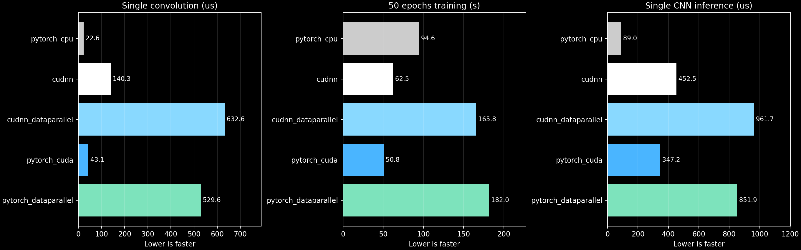
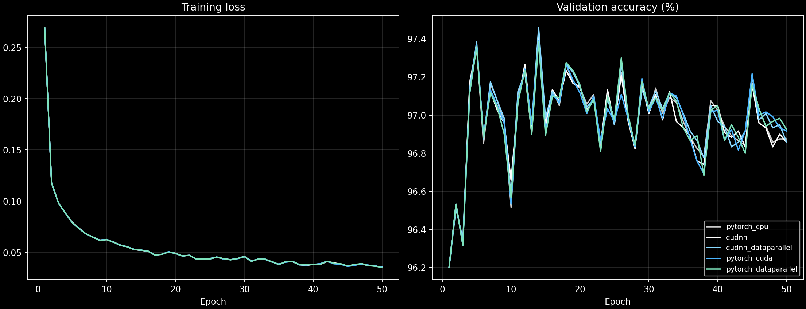

# CNN CUDA Case Study

**Inside a CNN: parallel 2D convolution on CPU, one GPU and two GPUs.**

A 6,810-parameter MNIST classifier with C++/OpenMP operation benchmarks, direct cuDNN calls and PyTorch baselines. The full-dataset Kaggle experiment completed **50 epochs in all five configurations**. Source code lives in reusable modules; the notebook fetches the exact GitHub commit and retains checkpoints, predictions and metrics.

[Presentation](presentation/CNN_CUDA_Case_Study.pptx) · [Full-MNIST notebook](notebooks/experiment_full_mnist.ipynb) · [Kaggle run](https://www.kaggle.com/code/satyapaladugu/cnn-cuda-case-study-full-mnist) · [Measured report](reports/full-mnist-2026-10-14/REPORT.md) · [Raw metrics](reports/full-mnist-2026-10-14/all_results.json) · [Result archive](https://github.com/saltypal/CNN-CUDA-Case-Study/releases/tag/v2.0.0)

## Full MNIST results

All five final models were evaluated on **10,000 official test images**. Final test accuracy is **97.13–97.17%** across the five models. **PyTorch, 1 GPU** had the lowest 50-epoch training time at **50.80 s**. The results below are newly measured on the full dataset.

| Implementation | Convolution (µs) | 50-epoch training (s) | Digit inference (µs) | Batch-64 inference (img/s) | Test accuracy |
|---|---:|---:|---:|---:|---:|
| PyTorch CPU | 22.65 | 94.59 | 88.96 | 60,449 | 97.13% |
| Direct cuDNN, 1 GPU | 140.33 | 62.49 | 452.48 | 139,617 | 97.17% |
| Direct cuDNN, 2 GPUs | 632.60 | 165.78 | 961.70 | 28,295 | 97.17% |
| PyTorch, 1 GPU | 43.05 | 50.80 | 347.21 | 180,668 | 97.17% |
| PyTorch DataParallel, 2 GPUs | 529.62 | 181.97 | 851.90 | 21,055 | 97.15% |

Convolution measures one digit, four 3×3 filters and output allocation. Digit inference measures the complete CNN forward pass. Both are warmed median completed-call wall latencies with input resident on the device. Batch throughput uses a batch of 64. Training time sums synchronized epoch intervals and excludes validation, initial transfer, warmup and checkpoint I/O.



PyTorch CPU had the lowest single-digit inference latency. PyTorch, 1 GPU had the highest batch-64 inference throughput. The best choice depends on the amount of work in each request. This is one seed and one runtime, so small timing differences do not establish a universal ranking.

## One GPU versus two GPUs

| Matching engine | Training speedup | Efficiency on 2 GPUs | GPU-time cost ratio |
|---|---:|---:|---:|
| Direct cuDNN | 0.377× | 18.85% | 5.31× |
| PyTorch | 0.279× | 13.96% | 7.16× |

The global batch stays at 64, giving each two-GPU replica 32 examples. Speedup is `T1/T2`, efficiency is `T1/(2*T2)`, and GPU-time cost ratio is `2*T2/T1`. A speedup below one means the second GPU increased training time. GPU-time is a resource proxy; energy, monetary charges and Kaggle quota use were not measured.

DataParallel adds model replication, host dispatch, scatter/gather and gradient reduction. Those costs must be compared with the compute time saved. No profiler attribution was collected to assign exact percentages to individual overhead components.

## Prescribed model and setup

| Stage | Per-image shape |
|---|---|
| Grayscale input | 1 × 28 × 28 |
| Four 3×3 filters, stride 1, valid padding | 4 × 26 × 26 |
| ReLU and 2×2 max pooling | 4 × 13 × 13 |
| Flatten and linear classifier | 676 → 10 logits |

The CNN has **6,810 parameters**. Its convolution performs 24,336 MACs per digit. The convolution computes cross-correlation, with no spatial reversal of the filter.

Full [MNIST](https://yann.lecun.com/) provides 60,000 development images and 10,000 test images. The development collection is split into **48,000 training and 12,000 validation images**, preserving the previous 80/20 ratio. Proportional stratification retains every image and preserves each digit's frequency. All **10,000 official test images** remain separate. Exact indices are saved and audited.

Every configuration uses **50 epochs, batch 64, seed 42, FP32, SGD learning rate 0.05 and momentum 0.9**. TF32 is disabled. Initial parameter bytes, data splits and epoch shuffle orders are identical. Each configuration performs 37,500 optimizer steps. Final test results use epoch-50 checkpoints; validation-selected checkpoints are retained separately.



## Implementation boundary

| Component | Implementation |
|---|---|
| Native CPU convolution | C++ loops, serial and four OpenMP workers |
| GPU convolution | cuDNN CUDA library kernels |
| Convolution gradients | cuDNN backward primitives with PyTorch autograd integration |
| Direct cuDNN | C API calls with fixed convolution algorithms |
| Other CNN operations | PyTorch ReLU, pooling, linear layer, loss and SGD |
| Two-GPU execution | PyTorch DataParallel around the selected convolution engine |

Five training paths compare PyTorch CPU, direct cuDNN on one/two GPUs, and PyTorch GPU on one/two GPUs. Handwritten CUDA configurations are excluded. The comparison changes convolution while retaining one classifier and training loop. PyTorch GPU also dispatched cuDNN in the observed trace, so the direct cuDNN/PyTorch comparison includes API overhead and algorithm choices on the same hardware. Tensor Core usage was not verified.

## Run and reproduce

Import [the full-MNIST notebook](notebooks/experiment_full_mnist.ipynb) into Kaggle, select **GPU T4 x2**, enable Internet and run all cells. To reproduce these results, set:

```python
SOURCE_REF = "42624fca4ba9b278076097e076363057b2d32a27"
```

The first setup cell removes only a dedicated temporary source checkout, clones GitHub and checks out the requested commit. Results use the separate `/kaggle/working/cnn-cuda-case-study-full-mnist-results` directory. Save a notebook version with outputs to retain them after the runtime ends. The release archive provides an additional persistent copy.

The measured runtime used Python 3.13.15, PyTorch 2.11.0+cu128, CUDA runtime 12.8 and cuDNN 91900. Saved environment JSON records the CPU, both GPUs, compilers, source hash and package versions. Future Kaggle runtimes may differ.

In a compatible Linux/WSL environment:

```bash
git clone https://github.com/saltypal/CNN-CUDA-Case-Study.git
cd CNN-CUDA-Case-Study
git checkout 42624fca4ba9b278076097e076363057b2d32a27
export PYTHONPATH="$PWD/src"
python -m hpc_cnn.run --config config_full_mnist.json --run-root results/full-mnist
python scripts/audit_results.py --run-root results/full-mnist --source-ref 42624fca4ba9b278076097e076363057b2d32a27
python -m hpc_cnn.demo --config config_full_mnist.json --run-root results/full-mnist
```

The native CPU operation benchmark needs a Linux C++ compiler with OpenMP. The GPU CNN paths need a compatible PyTorch/cuDNN runtime. Two-GPU configurations require two CUDA GPUs. CUDA kernels do not execute on TPU hardware.

## Saved evidence and limits

**119 numerical correctness checks passed.** Forward results and all convolution gradients match the framework reference within tolerance, including non-square inputs and multiple channels. A hand-computed example, a finite-difference derivative and DataParallel checks provide additional evidence.

The [independent audit](reports/full-mnist-2026-10-14/audit.json) verifies full dataset coverage, disjoint splits, identical initial parameter bytes and split indices, 50 epoch records for every backend, timing sums, all 10,000 test predictions per backend and the source commit. Separately trained models can diverge slightly because floating-point reduction order changes their training trajectories.

The operation benchmarks also retain serial/OpenMP CPU comparisons, H2D/D2H transfer times and host enqueue time and a DataParallel identity diagnostic. The identity diagnostic is not an exact subtraction of CNN communication overhead. GPU-event intervals can include submission gaps.

Peak RSS includes framework resources. GPU memory reports sum per-device tensor allocation peaks, which may occur at different times and exclude driver/context allocation. Energy and currency cost remain unavailable. Fixed 50-epoch timing is different from time to a target accuracy.

## Presentation and demo

The 13-slide presentation follows the supplied reference style. Presenter names appear only on the cover. The speaking sections are:

- **Prithvi**, slides 2–4: CNN, sequential versus parallel work, CPU/OpenMP execution.
- **Satya**, slides 5–9: GPGPU, dedicated GPU memory and batching, CUDA execution, library kernels and program design, DataParallel.
- **Roydon**, slides 10–13: measured results, scaling and cost, accuracy, conclusions and demo.

The slides explain output ownership, loop-end barriers, stream dependencies, gradient reductions and one synchronized DataParallel update. The additional dGPU slide uses the measured batch-1 and batch-64 inference results; no wider batch sweep is claimed.

The demo loads all five final checkpoints and predicts the same held-out digits. Cold loading is separate from warmed inference latency. In the completed Kaggle runtime:

```bash
cd /kaggle/working/cnn-cuda-case-study-source
PYTHONPATH=src python -m hpc_cnn.demo --config /kaggle/working/cnn-cuda-case-study-full-mnist-results/run_config_full_mnist.json --run-root /kaggle/working/cnn-cuda-case-study-full-mnist-results
```

## Source map and original study

Core modules are in `src/hpc_cnn`: `data.py` prepares splits, `native/conv_cpu.cpp` implements the CPU operation benchmark, `backends.py` binds native/cuDNN operations, `model.py` creates the shared classifier, `train.py` trains it, `benchmark.py` measures operations, `report.py` writes results, and `demo.py` reuses saved checkpoints. `scripts/audit_results.py` independently audits the completed run. [DESIGN.md](DESIGN.md) describes the module contracts.

The original **10% MNIST experiment** remains archived in [reports/kaggle-2026-10-14](reports/kaggle-2026-10-14/REPORT.md), with its [notebook](notebooks/experiment.ipynb) and [v1.0.0 artifacts](https://github.com/saltypal/CNN-CUDA-Case-Study/releases/tag/v1.0.0). Those measurements describe a smaller workload and a separate runtime.
